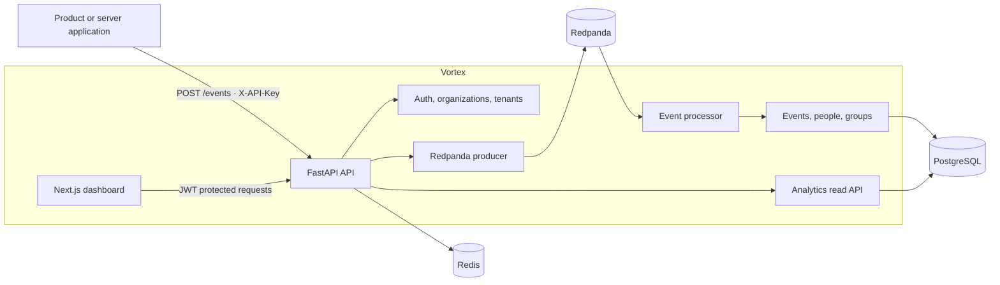

# Vortex

Vortex is a self-hostable product analytics platform. Applications send events to an API key authenticated endpoint; Vortex validates and queues them, resolves people and groups, stores the resulting records in PostgreSQL, and provides organization-scoped analytics for the dashboard.

The repository contains a **FastAPI backend** and a **Next.js frontend**. The backend owns the write pipeline, data model, authentication, tenant and key management, and analytics read API. The frontend provides the account flows and organization dashboard.

[Backend guide](backend/README.md) · [Frontend guide](frontend/README.md) · [Backend architecture SVG](backend/architecture.svg)

## Capabilities

- Organization signup, member invitations, role-aware access, and session refresh.
- Tenant and API key management, including key rotation and revocation.
- Event ingestion authenticated with `X-API-Key`.
- Asynchronous event processing through Redpanda into PostgreSQL.
- Person identity resolution, `$identify` handling, group records, and person-to-group links.
- Organization analytics for totals, time series, top events, property breakdowns, active users, and recent events.
- A responsive web dashboard for analytics, members, tenants, API keys, and account settings.

## Architecture

The API acknowledges accepted events after publishing them to Redpanda. The separate event processor consumes the topic in batches, applies identity and group updates, writes to PostgreSQL in a transaction, then commits Redpanda offsets. Dashboard analytics read from the PostgreSQL event table through the analytics module.



## Repository layout

```text
backend/
├── src/vortex/
│   ├── analytics/       # PostgreSQL-backed analytics queries
│   ├── auth/            # Login, refresh, logout, and access dependencies
│   ├── events/          # Event schemas, persistence models, and processing services
│   ├── organizations/   # Organization signup and memberships
│   ├── tenants/         # Tenant and API key lifecycle
│   ├── users/           # Signed-in user profile
│   ├── shared/          # Settings, DB, Redis, Redpanda, middleware, responses
│   ├── event_processor.py
│   └── main.py          # FastAPI application entry point
├── alembic/             # Database schema revisions
├── compose.yml          # PostgreSQL, Redis, migration, API, event processor
└── compose.redpanda.yml # Local Redpanda broker
frontend/
├── src/app/             # Public pages and authenticated dashboard routes
├── src/components/      # Shared layout, navigation, charts, and UI
├── src/lib/             # API client and authentication state
└── src/services/        # Typed API methods and data types
```

## Run locally

### Requirements

- Docker Engine with Docker Compose
- Python 3.14 and `uv` for running or managing the backend outside Docker
- Node.js and npm for the frontend

### Start backend services

From the repository root:

```bash
cd backend
cp example.env .env
```

Edit `backend/.env`. In particular, replace the PostgreSQL password and provide a valid matching JWT private and public key pair before using authentication. Keep `.env` secrets out of source control.

The backend Compose file expects the shared Redpanda network. Create it once, then start Redpanda:

```bash
docker network create my-redpanda-net
docker compose -p redpanda-local -f compose.redpanda.yml up -d
```

Start PostgreSQL, Redis, the migration job, API, and event processor:

```bash
docker compose up --build -d
```

The API is available at [http://localhost:8000](http://localhost:8000). FastAPI's OpenAPI UI is at [http://localhost:8000/docs](http://localhost:8000/docs). The current app does not define a dedicated `/health` route.

To inspect application logs:

```bash
docker compose logs -f fastapi event-processor
```

### Start the frontend

In another terminal:

```bash
cd frontend
cp .env.example .env.local
npm install
npm run dev
```

The frontend uses `NEXT_PUBLIC_API_URL`; the example points to `http://localhost:8000`. Open [http://localhost:3000](http://localhost:3000).

## Event flow

1. A client sends an event to `POST /events` with an `X-API-Key` header.
2. The API validates the event, adds server-owned organization, tenant, API key, receipt time, and request metadata, then publishes it to the configured Redpanda topic.
3. The event processor consumes records in batches. It resolves `distinct_id` values to people, processes valid identity links, resolves groups, and prepares event rows.
4. Identity, group, and event changes are persisted in one PostgreSQL transaction. The consumer commits the corresponding Redpanda offsets only after the database transaction succeeds.
5. The dashboard calls authenticated analytics endpoints, which query PostgreSQL by organization and optional tenant/date filters.

The `202 Accepted` response from event ingestion means the event was published for processing; it does not mean that database persistence has finished. See [backend/README.md](backend/README.md) for data tables, APIs, and processing details.

## Testing

**Status: Pending.** Test commands and results will be added after the project test workflow has been established and run.

## License

No license terms are currently documented in this repository. Add a license before redistributing the project under open-source terms.
