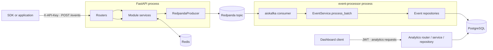

# Vortex Backend

The backend provides the Vortex HTTP API and event pipeline. It handles organization and user authentication, tenant and API key management, event ingestion, asynchronous event persistence, and analytics reads.

[Project overview](../README.md) · [Frontend guide](../frontend/README.md) · [Backend architecture SVG](architecture.svg)

## Architecture

The FastAPI process handles HTTP requests and publishes accepted events. A separate `event-processor` process consumes Redpanda records and writes event data to PostgreSQL. The analytics module reads from PostgreSQL and does not participate in event ingestion. Redis supports API key verification and authentication-related state.



The event-processing path in more detail:

```mermaid
sequenceDiagram
    autonumber
    participant Client
    participant API as FastAPI
    participant RP as Redpanda
    participant Worker as Event processor
    participant DB as PostgreSQL

    Client->>API: POST /events with X-API-Key
    API->>API: Validate client event and attach trusted IDs
    API->>RP: Publish JSON event
    API-->>Client: 202 Accepted
    RP->>Worker: Deliver topic records
    Worker->>Worker: Validate records and form a batch
    Worker->>DB: Resolve identities and groups; insert event rows
    DB-->>Worker: Commit transaction
    Worker->>RP: Commit offsets after DB commit
```

## Backend modules

| Module | Responsibility |
|---|---|
| `auth` | Login, refresh-token rotation, logout, JWT dependencies, and role checks. |
| `organizations` | Organization signup, current organization, member invitations, and membership changes. |
| `tenants` | Tenant listing/creation and API key creation, verification, rotation, and revocation. |
| `users` | Signed-in user's profile. |
| `events` | Client event schema, five event-related tables, batch persistence repositories, and processing services. |
| `analytics` | Read-only query endpoints and SQL over the `events` table; imports the event model without making the events module depend on analytics. |
| `shared` | Settings, database session helpers, Redis, Redpanda producer, middleware, API response envelopes, and shared utilities. |

The event tables are:

| Table | Purpose |
|---|---|
| `events` | One ingested event with organization, tenant, API key, event properties, timestamps, and resolved person/group references. |
| `persons` | Mutable person profile properties scoped to a tenant. |
| `person_distinct_ids` | Maps tenant-scoped client identifiers to person records. |
| `groups` | Tenant-scoped group records and properties. |
| `person_groups` | Links people to groups. |

## HTTP API

All routers are included through `api/routers.py`. Most responses use the shared envelope: `message`, `status_code`, `data`, and `meta`.

### Authentication and workspace

| Method | Route | Purpose |
|---|---|---|
| `POST` | `/organizations/signup` | Create an organization and its initial account. |
| `POST` | `/auth/login` | Authenticate and issue an access token plus refresh cookie. |
| `POST` | `/auth/refresh` | Rotate the refresh token and issue a new access token. |
| `POST` | `/auth/logout` | Revoke the session and clear the refresh cookie. |
| `GET` | `/users/me` | Read the current user. |
| `GET` | `/organizations/me` | Read the current organization. |
| `GET` | `/organizations/members` | List active organization members. |
| `POST` | `/organizations/invite` | Invite a member. |
| `DELETE` | `/organizations/members/{user_id}` | Deactivate a member. |

### Tenants and API keys

| Method | Route | Purpose |
|---|---|---|
| `POST` | `/tenants` | Create a tenant. |
| `GET` | `/tenants` | List organization tenants. |
| `POST` | `/tenants/api-key` | Create an API key. The raw key is shown at creation. |
| `GET` | `/tenants/api-keys?tenant_id=...` | List API keys for a tenant. |
| `POST` | `/tenants/api-keys/rotate` | Rotate an API key. |
| `DELETE` | `/tenants/{tenant_id}/api-keys/{api_key_id}` | Revoke an API key. |

### Events and analytics

| Method | Route | Authentication | Purpose |
|---|---|---|---|
| `POST` | `/events` | `X-API-Key` | Validate and publish one event for asynchronous processing. |
| `GET` | `/analytics/overview` | Bearer token | Event, unique-user, and session totals with previous-period comparisons. |
| `GET` | `/analytics/timeseries` | Bearer token | Event counts by hour or day. |
| `GET` | `/analytics/top-events` | Bearer token | Most frequent event names. |
| `GET` | `/analytics/breakdown` | Bearer token | Counts grouped by a selected event property. |
| `GET` | `/analytics/active-users` | Bearer token | Distinct people by day, week, or month. |
| `GET` | `/analytics/events/recent` | Bearer token | Recent raw event records. |

Analytics routes accept `from` and `to`, plus optional `event_name` and `tenant_id` filters. Analytics scope defaults to the current organization and can be narrowed to one of its tenants.

## Event processing and delivery

`POST /events` validates the client payload using `EventRequestSchema`. The server derives organization, tenant, and API key IDs from the verified API key and adds receipt time and request metadata. It publishes to `REDPANDA_EVENTS_TOPIC` and returns `202` after the broker acknowledges the publish.

The `event-processor` runs `src.vortex.event_processor`. It consumes up to 5,000 records at a time with auto-commit disabled. It validates incoming records, skips malformed records, resolves person and group rows in bulk, and inserts processable events in a PostgreSQL transaction. For a record without a client `insert_id`, it derives a stable UUIDv5 from the topic, partition, and offset so replaying that same broker record does not duplicate its event row. Consumer offsets are committed after successful persistence.

`$identify` updates tenant-scoped mappings from anonymous to known distinct IDs. Ambiguous or cyclic identify links in a batch are skipped; other valid records in the batch can still be processed. Events with a `group_key` resolve a group and link the person to it.

## Local development

### Docker Compose

From `backend/`:

```bash
cp example.env .env
```

Set local values in `.env`, especially database credentials and a valid matching JWT key pair. The sample JWT values are placeholders and are not usable for authentication.

The application Compose file uses the external Docker network `my-redpanda-net`. Create it once per Docker host, then start the local broker and application stack:

```bash
docker network create my-redpanda-net
docker compose -p redpanda-local -f compose.redpanda.yml up -d
docker compose up --build -d
```

The backend Compose stack contains PostgreSQL, Redis, a one-shot Alembic migration service, FastAPI, and the Redpanda event processor. The API, processor, and migration service bind-mount the local source, Alembic directory, and `alembic.ini`, so code and migration edits are visible inside those containers without rebuilding the image. Redpanda is started from its separate Compose file. The backend service targets the broker at `redpanda:19092` over the shared network.

The `vortex_pg_data` named volume keeps PostgreSQL data and the applied Alembic revision across container restarts. Editing or removing local migration files does not erase that database history. After changing a migration, run the one-shot migration service explicitly:

```bash
docker compose run --rm migrate
```

Keep a valid Alembic revision chain for any database that already has applied revisions. A new baseline with a different revision ID does not automatically replace the revision stored in PostgreSQL.

Useful endpoints: `http://localhost:8000/docs` and `http://localhost:8000/` (Scalar API reference). Follow service logs with:

```bash
docker compose logs -f fastapi event-processor
```

### Run the API on the host

Install Python 3.14, `uv`, and the infrastructure services. From `backend/`, copy `example.env` to `.env`, then adjust the Postgres host/port and Redpanda bootstrap address for host access (`localhost:5433` and `localhost:9092` with the provided Compose ports).

```bash
uv sync --frozen
uv run alembic upgrade head
uv run uvicorn src.vortex.main:app --reload --host 0.0.0.0 --port 8000
```

Run the event processor in another terminal from `backend/`:

```bash
uv run python -m src.vortex.event_processor
```

### Configuration reference

`example.env` is the variable template. Pydantic Settings reads required application, PostgreSQL, Redis, JWT, CORS, API-key, and Redpanda values from the environment or `.env`.

| Variable group | Used for |
|---|---|
| `POSTGRES_*` | PostgreSQL connection. |
| `REDIS_*` | API key verification cache and auth-related Redis operations. |
| `JWT_*`, `ALGORITHM`, `ACCESS_TOKEN_EXPIRE_SECONDS` | Access-token signing and validation. |
| `ENVIRONMENT`, `PROJECT_NAME`, `VERSION`, `DOCS_ENDPOINT` | Application configuration. Request timing logs and response header are enabled outside the `live` environment. |
| `ALLOWED_*`, `ALLOW_CREDENTIALS`, `CORS_MAX_AGE` | CORS policy. |
| `API_KEY_PREFIX`, `GRACE_PERIOD_MINS` | API key creation and rotation. |
| `REDPANDA_*` | Broker client, topic, consumer group, security, and producer settings. |

Do not commit `.env` files or production credentials.

## Migrations and tests

Database schema changes are managed by Alembic under `alembic/versions/`. The Compose `migrate` service runs `alembic upgrade head` before the API and event processor start.

**Testing status: Pending.** Test commands and results will be documented after the backend test workflow has been established and run.
